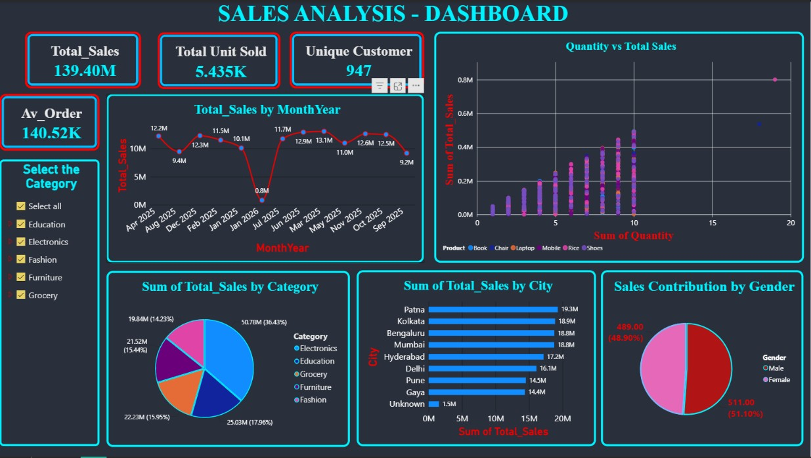

# Sales Analysis & Customer Segmentation – Power BI Dashboards

This folder contains the Power BI dashboards and supporting files for sales performance analysis and RFM-based customer segmentation.

## 1. Sales Analysis Dashboard

The dashboard presents sales KPIs and breakdowns such as monthly sales trends, category-wise sales, city-wise sales, gender contribution, and quantity versus sales.

### Key Metrics
- Total Sales: ₹139.40M
- Total Units Sold: 5.435K
- Unique Customers: 947
- Average Order Value: ₹140.52K

## 2. Customer Segmentation Dashboard

The customer segmentation work uses the RFM model:

| Metric | Meaning |
|---|---|
| Recency | Days since the customer's last purchase |
| Frequency | Number of distinct orders placed |
| Monetary | Total amount spent |

Customers were assigned scores from 1 to 5 and classified into five segments.

### Customer Segmentation Results

| Customer Segment | Customers | Revenue |
|---|---:|---:|
| High Value Recent | 165 | ₹44.22M |
| At Risk High Value | 147 | ₹38.55M |
| Regular Customers | 189 | ₹27.89M |
| Inactive Low Value | 232 | ₹14.69M |
| Recent Low Value | 214 | ₹14.06M |
| **Total** | **947** | **₹139.40M** |

### Business Insights
- Inactive Low Value is the largest segment, with 232 customers.
- High Value Recent customers contribute approximately ₹44.22M.
- At Risk High Value customers contribute approximately ₹38.55M.
- Most customers have only one recorded order, so repeat-purchase patterns should be interpreted cautiously.

## Files in This Folder
- `Customer_Segmentation.pbix`: Customer segmentation Power BI report
- `Dashboard_P_BI.pbix`: Sales analysis Power BI report
- `Sales_Analysisi_Dashboard.jpg`: Sales dashboard screenshot
- `CUSTOMER SEGMENTATION ANALYSIS - DASHBOARD.jpg`: Customer segmentation dashboard screenshot
- `Customer_RFM_Segmentation.csv`: Customer-level RFM output
- `Segment_Summary.csv`: Segment-level summary
- `Dash.ipynb`: Supporting analysis notebook
- `cleaned_sales.csv`: Dataset used for analysis

## Tools
Python, Pandas, NumPy, Matplotlib, Seaborn, Power BI, DAX, and Power Query.

## Author
**Rohit Singh**  
MCA Final-Year Student | Aspiring Data Analyst

- LinkedIn: [Rohit Singh](https://www.linkedin.com/in/rohitsinghsomvanshi/)
- GitHub: [rohitsinghsomvanshi](https://github.com/rohitsinghsomvanshi)
